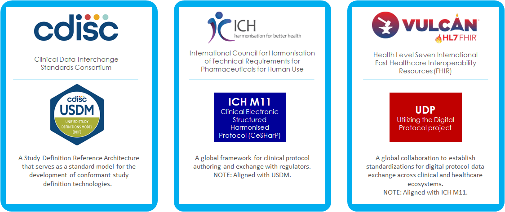

# Data Resources for Digital Data Flow

The foundation of Digital Data Flow begins with standardized, structured data. Explore the industry collaborations of core standards and support materials that help transform protocol information into structured, interoperable data.​

## Standards
Click below to access the various standards.

  
  
  
  

## Other Support Materials
Learn more and access additional resources and tools to support your understanding and usage of the standards. 

  
  
  

