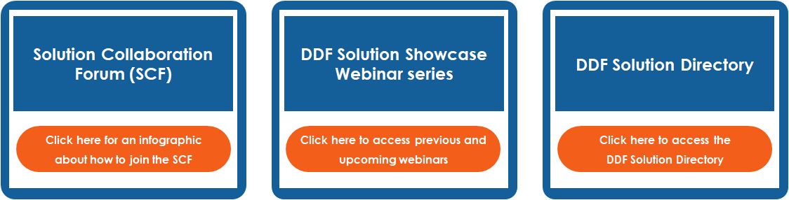

# Solution Provider Resources 
To implement DDF solutions, technology ecosystem updates are recommended. How technology updates are  implemented can greatly vary by company. The following provides resources that can support this process. 

  
  
  
  

